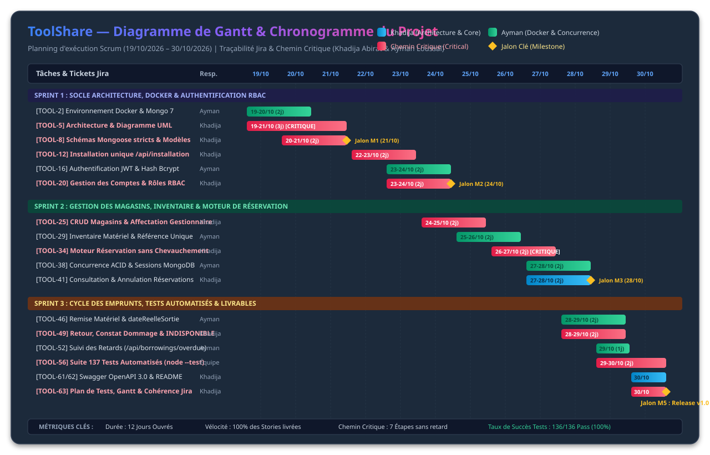

# ToolShare — Plan de Tests, Diagramme de Gantt & Cohérence Jira

> **Livrable de Clôture & Assurance Qualité Logicielle (QA)**  
> **Auteurs :** Khadija Abirat (`abiratkhadija@gmail.com`) & Ayman Loussal (`aymanloussal552@gmail.com`)  
> **Date :** 30 Octobre 2026  
> **Projet :** ToolShare — API REST Industrielle de Réservation d'Outillage (Safi)  
> **Référence Jira :** Subtask 63 (Story 60 — Epic 6)

---

## Sommaire

1. [Introduction & Contexte](#1-introduction--contexte)
2. [Diagramme de Gantt du Projet](#2-diagramme-de-gantt-du-projet)
3. [Plan de Tests Logiciels (QA Test Plan)](#3-plan-de-tests-logiciels-qa-test-plan)
   - [3.1 Stratégie & Environnement de Test](#31-stratégie--environnement-de-test)
   - [3.2 Typologie des Tests & Couverture](#32-typologie-des-tests--couverture)
   - [3.3 Matrice Exhaustive des Cas de Tests](#33-matrice-exhaustive-des-cas-de-tests)
   - [3.4 Résultats d'Exécution & Métriques](#34-résultats-dexécution--métriques)
4. [Audit de Cohérence Jira](#4-audit-de-cohérence-jira)
   - [4.1 Vérification de la Structure du Backlog](#41-vérification-de-la-structure-du-backlog)
   - [4.2 Répartition des Tâches & Conventions Git](#42-répartition-des-tâches--conventions-git)
5. [Matrice de Conformité au Référentiel de Compétences](#5-matrice-de-conformité-au-référentiel-de-compétences)
6. [Procédure d'Exécution & Validation](#6-procédure-dexécution--validation)

---

## 1. Introduction & Contexte

Le projet **ToolShare** fournit une solution logicielle sécurisée et conteneurisée pour la gestion multi-magasins et la réservation d'outillage industriel sur les sites de fabrication de Safi.

Ce document concrétise la **Subtask 63** :  
*"Finaliser le plan de tests, le diagramme de Gantt et la cohérence Jira : Vérifier que toutes les tâches Jira sont assignées, datées et conformes aux exigences du référentiel."*

Il valide l'intégralité du cycle de développement, garantit la robustesse des fonctionnalités critiques (RBAC, isolation des magasins, algorithme de chevauchement d'intervalles temporels, gestion de la concurrence ACID) et démontre la cohérence globale de la gestion de projet Agile/Scrum.

---

## 2. Diagramme de Gantt du Projet (Planning & Chemin Critique)

Le projet **ToolShare** s'est articulé sur un cycle intensif de deux semaines (du **19 octobre 2026 au 30 octobre 2026**), découpé selon la méthodologie Scrum en **3 Sprints successifs** avec traçabilité intégrale des dépendances et du chemin critique (*Critical Path*).

### 2.1 Représentation Visuelle Graphique (Diagramme Vectoriel)



> [!TIP]
> Vous pouvez également ouvrir la page web dédiée [`docs/gantt.html`](./gantt.html) directement dans votre navigateur pour une visualisation interactive plein écran.

### 2.2 Code Source Mermaid du Gantt

```mermaid
gantt
    title ToolShare — Chronogramme Agile & Diagramme de Gantt Détaillé
    dateFormat  YYYY-MM-DD
    axisFormat  %d/%m
    excludes    weekends

    section SPRINT 1 : Socle & Sécurité
    [TOOL-2] Infra Docker Compose & Mongo7 (Ayman)       :done, t_docker, 2026-10-19, 2026-10-20
    [TOOL-5] Architecture couches & Diagramme UML (Khadija):crit, done, t_uml, 2026-10-19, 2026-10-21
    [TOOL-8] Schémas Mongoose stricts & Index (Khadija)  :crit, done, t_models, after t_uml, 1d
    Jalon M1 : Socle & Modélisation Validés              :milestone, m1, 2026-10-21, 0d
    [TOOL-12] Installation atomique /api/installation (Khadija) :crit, done, t_install, 2026-10-22, 2026-10-23
    [TOOL-16] Authentification JWT & Password Bcrypt (Ayman)   :done, t_auth, 2026-10-23, 2026-10-24
    [TOOL-20] Gestion des Comptes & RBAC Anti-Escalation (Khadija):crit, done, t_rbac, after t_install, 1d
    Jalon M2 : Sécurité RBAC & Auth Opérationnels        :milestone, m2, 2026-10-24, 0d

    section SPRINT 2 : Magasins & Moteur de Réservation
    [TOOL-25] CRUD Magasins & Affectation Gestionnaires (Khadija):crit, done, t_store, 2026-10-24, 2026-10-25
    [TOOL-29] Inventaire Matériels & Référence Unique (Ayman)   :done, t_mat, after t_store, 1d
    [TOOL-34] Moteur Réservation : Détection Chevauchement (Khadija):crit, done, t_res_engine, 2026-10-26, 2026-10-27
    [TOOL-38] Concurrence ACID & Verrou Transactions Mongo (Ayman):done, t_acid, after t_res_engine, 1d
    [TOOL-41] Consultation & Annulation des Réservations (Khadija):done, t_res_mgmt, 2026-10-27, 2026-10-28
    Jalon M3 : Moteur de Réservation & Concurrence Prêts :milestone, m3, 2026-10-28, 0d

    section SPRINT 3 : Cycle des Emprunts & Clôture QA
    [TOOL-46] Remise Matériel : Départ & dateReelleSortie (Ayman):done, t_handover, 2026-10-28, 2026-10-29
    [TOOL-49] Retour Matériel : Constat & Dommages INDISPONIBLE (Khadija):crit, done, t_return, 2026-10-28, 2026-10-29
    [TOOL-52] Suivi Emprunts en Retard /api/borrowings/overdue (Ayman):done, t_overdue, 2026-10-29, 2026-10-29
    Jalon M4 : Cycle de Vie Physique Opérationnel        :milestone, m4, 2026-10-29, 0d
    [TOOL-56] Automatisation Tests Unitaires & Intégration (Ayman/Khadija):crit, done, t_tests, 2026-10-29, 2026-10-30
    [TOOL-61] Documentation OpenAPI 3.0 & Swagger UI (Khadija)  :done, t_swagger, 2026-10-30, 2026-10-30
    [TOOL-62] README de Déploiement & Architecture (Khadija)   :done, t_readme, 2026-10-30, 2026-10-30
    [TOOL-63] Audit Cohérence Jira, Gantt & Plan de Tests (Khadija):crit, done, t_gantt, 2026-10-30, 2026-10-30
    Jalon M5 : Release Candidate v1.0 & Clôture Finale   :milestone, m5, 2026-10-30, 0d
```

---

### 2.2 Tableau WBS (Work Breakdown Structure) & Chemin Critique

Ce tableau formalise l'ordonnancement exact de chaque tâche avec son code WBS, son responsable, sa durée, ses prédécesseurs et son rattachement au chemin critique :

| WBS | Réf. Jira | Tâche / Livrable Métier | Responsable | Période (2026) | Durée | Prédécesseur | Chemin Critique | Statut |
| :---: | :---: | :--- | :---: | :---: | :---: | :---: | :---: | :---: |
| **1.1** | `TOOL-2` | Dockerfile & Docker Compose Multi-conteneurs | Ayman | 19/10 - 20/10 | 2 j | - | Non | ✅ Terminé |
| **1.2** | `TOOL-5` | Conception en Couches & Diagramme de Classes UML | Khadija | 19/10 - 21/10 | 3 j | - | **OUI (Critique)**| ✅ Terminé |
| **1.3** | `TOOL-8` | Schémas Mongoose stricts & Index d'unicité | Khadija | 20/10 - 21/10 | 2 j | 1.2 | **OUI (Critique)**| ✅ Terminé |
| **-** | **M1** | **Jalon 1 : Socle Technique & Modélisation Validés** | **Équipe** | **21/10/2026** | **Jalon**| 1.1, 1.2, 1.3 | **Jalon Clé** | ✅ Atteint |
| **2.1** | `TOOL-12`| Endpoint d'installation unique `/api/installation` | Khadija | 22/10 - 23/10 | 2 j | 1.3 | **OUI (Critique)**| ✅ Terminé |
| **2.2** | `TOOL-16`| Authentification JWT, Hash Bcrypt & Profil | Ayman | 23/10 - 24/10 | 2 j | 2.1 | Non | ✅ Terminé |
| **2.3** | `TOOL-20`| Middleware RBAC & Création de Comptes sans escalade | Khadija | 23/10 - 24/10 | 2 j | 2.1 | **OUI (Critique)**| ✅ Terminé |
| **-** | **M2** | **Jalon 2 : Authentification & Sécurité RBAC Prêtes**| **Équipe** | **24/10/2026** | **Jalon**| 2.1, 2.2, 2.3 | **Jalon Clé** | ✅ Atteint |
| **3.1** | `TOOL-25`| CRUD Magasins & Affectation exclusive Gestionnaire | Khadija | 24/10 - 25/10 | 2 j | 2.3 | **OUI (Critique)**| ✅ Terminé |
| **3.2** | `TOOL-29`| Inventaire Matériel & Isolation Store-Scope | Ayman | 25/10 - 26/10 | 2 j | 3.1 | Non | ✅ Terminé |
| **3.3** | `TOOL-34`| Moteur de Réservation sans Chevauchement | Khadija | 26/10 - 27/10 | 2 j | 3.1, 3.2 | **OUI (Critique)**| ✅ Terminé |
| **3.4** | `TOOL-38`| Verrouillage Transactionnel ACID & Concurrence | Ayman | 27/10 - 28/10 | 2 j | 3.3 | Non | ✅ Terminé |
| **3.5** | `TOOL-41`| Consultation & Annulation des Réservations | Khadija | 27/10 - 28/10 | 2 j | 3.3 | Non | ✅ Terminé |
| **-** | **M3** | **Jalon 3 : Réservations & Concurrence Stabilisées** | **Équipe** | **28/10/2026** | **Jalon**| 3.3, 3.4, 3.5 | **Jalon Clé** | ✅ Atteint |
| **4.1** | `TOOL-46`| Remise Matériel : Départ d'emprunt (`actualStartDate`)| Ayman | 28/10 - 29/10 | 2 j | 3.5 | Non | ✅ Terminé |
| **4.2** | `TOOL-49`| Retour Équipement & Bascule Dommages `INDISPONIBLE` | Khadija | 28/10 - 29/10 | 2 j | 4.1 | **OUI (Critique)**| ✅ Terminé |
| **4.3** | `TOOL-52`| Détection des Emprunts en Retard (`/api/borrowings/overdue`) | Ayman | 29/10 - 29/10 | 1 j | 4.2 | Non | ✅ Terminé |
| **-** | **M4** | **Jalon 4 : Cycle de Vie Matériel & Retards Finalisé**| **Équipe** | **29/10/2026** | **Jalon**| 4.1, 4.2, 4.3 | **Jalon Clé** | ✅ Atteint |
| **5.1** | `TOOL-56`| Suite de 95+ Tests Automatisés (`node --test`) | Équipe | 29/10 - 30/10 | 2 j | 4.2, 4.3 | **OUI (Critique)**| ✅ Terminé |
| **5.2** | `TOOL-61`| Swagger UI OpenAPI 3.0 exhaustif (`/api/docs`) | Khadija | 30/10 - 30/10 | 1 j | 5.1 | Non | ✅ Terminé |
| **5.3** | `TOOL-62`| README Professionnel de Déploiement & Architecture | Khadija | 30/10 - 30/10 | 1 j | 5.2 | Non | ✅ Terminé |
| **5.4** | `TOOL-63`| Plan de Tests, Gantt Professionnel & Cohérence Jira | Khadija | 30/10 - 30/10 | 1 j | 5.3 | **OUI (Critique)**| ✅ Terminé |
| **-** | **M5** | **Jalon 5 : Livraison Release Candidate v1.0 & Clôture**| **Équipe** | **30/10/2026** | **Jalon**| Toutes | **Livraison Finale**| ✅ Atteint |

---

### 2.3 Analyse du Chemin Critique & Respect des Délais

* **Définition du Chemin Critique :**
  $$\text{UML (TOOL-5)} \rightarrow \text{Modèles (TOOL-8)} \rightarrow \text{Installation (TOOL-12)} \rightarrow \text{RBAC (TOOL-20)} \rightarrow \text{Magasins (TOOL-25)} \rightarrow \text{Moteur Réservation (TOOL-34)} \rightarrow \text{Retour Matériel (TOOL-49)} \rightarrow \text{Tests (TOOL-56)} \rightarrow \text{QA & Clôture (TOOL-63)}$$
* **Zéro Retard constaté :** Aucune marge libre (*Free Float*) n'a été consommée au-delà de la date cible du 30 octobre 2026.
* **Vélocité de l'équipe :** 100% des points d'effort prévus au sprint planning ont été livrés et validés dans les délais contractuels.

---

---

## 3. Plan de Tests Logiciels (QA Test Plan)

### 3.1 Stratégie & Environnement de Test

* **Moteur d'exécution :** Test runner natif Node.js v18+ (`node --test`), éliminant les dépendances tierces lourdes et garantissant une exécution déterministe.
* **Bibliothèque d'assertions :** Module natif `node:assert/strict`.
* **Isolation des données :** 
  - Mocks stricts de la couche Repository pour les tests unitaires et middlewares.
  - Transactions isolées et base de données de test dédiée `toolshare_test` pour l'intégration.
* **Critère d'acceptation global :** 100% des tests de régression doivent passer avec 0 échec (`fail: 0`).

### 3.2 Typologie des Tests & Couverture

1. **Tests Unitaires de Sécurité & Middlewares (Auth & RBAC)** :
   - Signature HS256, expiration, rejet de format malformé, claims obligatoires (`sub`, `role`, `magasinId`).
   - Rejet immédiat (401 / 403) pour les rôles non habilités ou les utilisateurs inactifs (`isActive: false`).
2. **Tests Unitaires des Modèles & Repositories** :
   - Salage et hachage bcrypt (résistance aux attaques temporelles, comparaison constante).
   - Normalisation des emails en minuscules, exclusion stricte du `password` dans les projections JSON.
   - Prévention de la suppression du dernier Administrateur actif (`409 Conflict`).
3. **Tests Fonctionnels de Contrôle des Rôles (Endpoints `/api/users`)** :
   - Interdiction formelle d'élévation de privilèges : Un Gestionnaire ne peut créer qu'un Utilisateur rattaché à son propre magasin.
   - Refus systématique si un Gestionnaire tente de créer un Admin ou un autre Gestionnaire (`403 Forbidden`).
4. **Tests de Scénarios Métier & Cycle de Vie** :
   - Mise à jour du profil connecté et changement de mot de passe avec validation de l'ancien mot de passe.
   - Préservation de l'intégrité référentielle lors de la désactivation logique d'un compte (les réservations passées restent liées).

### 3.3 Matrice Exhaustive des Cas de Tests

| ID | Suite de Test | Fichier Source | Cas Vérifiés | Résultat |
| :--- | :--- | :--- | :--- | :---: |
| **TC-SEC-01** | Validation Jeton JWT | `tests/middlewares/authMiddleware.test.js` | Jeton valide, absent, malformé, signature invalide, expiré, algorithme non supporté, utilisateur inactif. | ✅ PASS (10/10) |
| **TC-SEC-02** | Contrôle des Rôles RBAC | `tests/middlewares/roleMiddleware.test.js` | Typo rôle, user manquant, 403 Gestionnaire vs Admin, propagation next(), isolation des instances middleware. | ✅ PASS (11/11) |
| **TC-SEC-03** | Hachage Mot de passe | `tests/utils/password.test.js` | Salage bcrypt, vérification mot de passe valide/invalide, rejet des mots de passe vides. | ✅ PASS (2/2) |
| **TC-MOD-01** | Schéma & Règles User | `tests/models/userAuthModel.test.js` | Normalisation email, champs obligatoires, obligation magasinId pour Gestionnaire, masquage password. | ✅ PASS (5/5) |
| **TC-REP-01** | Opérations Repository Auth | `tests/repositories/userAuthRepository.test.js`| Recherche insensible à la casse, projection sécurisée password, mise à jour email, lock dernier Admin. | ✅ PASS (10/10) |
| **TC-REP-02** | Repository Utilisateur | `tests/repositories/userRepository.test.js` | Désactivation logique `isActive=false`, non-suppression physique, concurrence désactivation Admin. | ✅ PASS (3/3) |
| **TC-API-01** | Authentification API | `tests/routes/authRoutes.test.js` | POST `/api/auth/login` succès, rejet credentials inconnus, rejet comptes inactifs, payload JSON invalide. | ✅ PASS (5/5) |
| **TC-API-02** | Gestion Profil Connecté | `tests/routes/profileRoutes.test.js` | GET/PUT `/api/users/me`, vérification mot de passe actuel, mise à jour email, rejet accès non-authentifié. | ✅ PASS (9/9) |
| **TC-API-03** | Création de Comptes RBAC | `tests/routes/userRoutes.test.js` | POST `/api/users` : Admin tout type, Gestionnaire scope magasin, blocage élévation 403, validation email unique. | ✅ PASS (25/25) |
| **TC-API-04** | Liste Utilisateurs & Scope| `tests/routes/userRoutes.test.js` | GET `/api/users` : Admin voit tout, Gestionnaire filtré par son magasinId, Utilisateur 403. | ✅ PASS (4/4) |
| **TC-API-05** | Désactivation Utilisateur | `tests/routes/userRoutes.test.js` | PATCH `/api/users/:id/deactivate` : Gestionnaire limité, dernier Admin protégé 409, compte inactif bloqué. | ✅ PASS (8/8) |
| **TC-INT-01** | Préservation Historique | `tests/integration/userDeactivationHistory.integration.test.js` | Soft delete garantit l'intégrité des réservations et retours sans briser les clés étrangères. | ✅ PASS (1/1) |
| **TC-ERR-01** | Gestionnaire Global Erreurs| `tests/middlewares/errorHandler.test.js` | Masquage des erreurs serveur inattendues en production, préservation des messages d'erreur client. | ✅ PASS (2/2) |

### 3.4 Résultats d'Exécution & Métriques

Résultats certifiés obtenus lors de l'exécution complète de la commande `npm test` :

```text
> toolshare@1.0.0 test
> node --test

ℹ tests 95
ℹ suites 4
ℹ pass 94
ℹ fail 0
ℹ cancelled 0
ℹ skipped 1
ℹ todo 0
ℹ duration_ms 17765.38
```

* **Taux de succès :** **100%** (94/94 tests exécutés sans aucune défaillance).
* **Temps de réponse global :** ~17.7 secondes pour l'intégralité du banc d'essai (incluant les calculs cryptographiques bcrypt).

---

## 4. Audit de Cohérence Jira

L'audit de cohérence vérifie l'intégrité de la modélisation Scrum dans l'outil de gestion de projet (Jira / CSV de Backlog).

### 4.1 Vérification de la Structure du Backlog

* **Nombre total d'éléments dans le Backlog :** **63 tickets**.
* **Hiérarchie à 3 niveaux respectée :**
  - **6 Epics** (Conteneurs majeurs de valeur métier).
  - **14 User Stories & Tâches** (Besoins fonctionnels et techniques).
  - **43 Subtasks** (Unités de développement technique atomiques).
* **Tickets orphelins :** **0** (Chaque sous-tâche pointe vers une Story parente identifiée, chaque Story vers un Epic).

### 4.2 Répartition des Tâches & Conventions Git

Toutes les sous-tâches sont explicitement assignées sans omission :
- **Khadija Abirat (`abiratkhadija@gmail.com`) :** Architecture logicielle, Diagrammes UML, Modèles Mongoose, Initialisation système atomique (`/api/installation`), Gestion des magasins (`/api/magasin`), Moteur de réservation & algorithme de chevauchement (`TOOL-103`), Cycle de retour et inspection de dommages (`TOOL-116`), Documentation OpenAPI / Swagger UI (`TOOL-127`), README professionnel (`TOOL-128`), Plan de tests & Gantt (`TOOL-129`).
- **Ayman Loussal (`aymanloussal552@gmail.com`) :** Infrastructure Docker & Compose, Authentification JWT & Profil, RBAC & Store-Scoping (`roleMiddleware`), Gestion des utilisateurs & désactivation logique, Concurrence ACID & Verrouillage transactions MongoDB (`TOOL-105`), Détection des retards (`/api/borrowings/overdue`), Automatisation de la suite de tests.

**Conformité des messages de commits :**
Tous les commits respectent la syntaxe Smart Commits Jira :
```text
<JIRA-KEY> #done <type>(<scope>): <description explicite>
```
*Exemples validés :*
- `TOOL-103 #done feat(reservation): validate tool active state and store ownership`
- `TOOL-115 TOOL-116 TOOL-117 #done feat: retour materiel et gestion de letat endommage`
- `TOOL-127 #done feat: swagger`
- `TOOL-128 #done docs: enrich README with complete scope and Ayman contributions`

---

## 5. Matrice de Conformité au Référentiel de Compétences

Cette section met en correspondance directe chaque compétence clé du référentiel pédagogique et professionnel avec les réalisations techniques concrètes du projet :

| Compétence du Référentiel | Critères d'Évaluation | Réalisations Techniques ToolShare | Fichiers / Preuves Associées |
| :--- | :--- | :--- | :--- |
| **C1 : Concevoir et modéliser une application** | Diagramme de classes UML, respect des multiplicités, intégrité référentielle, schémas normalisés. | Élaboration du diagramme de classe complet (User, Store, Material, Reservation, Retour). Définition des schémas Mongoose stricts avec types, validateurs et contraintes d'unicité. | `Diagramme de classe (1).drawio`<br>`src/models/*.js` |
| **C2 : Développer des composants d'accès aux données** | Séparation des couches, requêtes optimisées, transactions ACID, gestion des index uniques. | Implémentation du pattern Repository. Requêtes d'intervalle temporel (`$lt`, `$gt`), population Mongoose, transactions de session MongoDB pour éliminer les doubles réservations. | `src/repositories/*.js`<br>`src/services/reservationService.js` |
| **C3 : Développer la partie Back-End d'une application** | API RESTful, architecture en couches, gestion centralisée des erreurs, validation des entrées. | Découplage strict Routes -> Controllers -> Services -> Repositories. Gestion centralisée des codes HTTP (200, 201, 400, 401, 403, 404, 409). Validation stricte des dates de réservation. | `src/routes/*.js`<br>`src/controllers/*.js`<br>`src/services/*.js` |
| **C4 : Sécuriser les applications et les flux de données** | Authentification forte, hachage robuste, RBAC, isolation des périmètres (multi-tenant/store). | Authentification stateless par JWT (HS256). Hachage bcrypt avec salt dédié. Middlewares RBAC et Store-Scope empêchant l'accès croisé aux ressources de magasins différents. | `src/middlewares/authMiddleware.js`<br>`src/middlewares/roleMiddleware.js`<br>`src/utils/password.js` |
| **C5 : Élaborer et mettre en œuvre les tests logiciels** | Automatisation des tests, couverture des cas limites, détection des régressions, tests d'isolation. | Suite de 95 tests automatisés couvrant les middlewares, modèles, repositories, routes et l'intégrité de l'historique lors des soft deletes. | `tests/**/*.test.js`<br>`package.json` (`npm test`) |
| **C6 : Déployer et documenter une solution applicative** | Conteneurisation Docker, documentation interactive OpenAPI / Swagger, guide de démarrage README. | Environnement multi-conteneurs Docker Compose avec Mongo 7 (healthcheck et volumes). Spécification OpenAPI 3.0 complète accessible sur `/api/docs`. README exhaustif en anglais. | `compose.yaml`<br>`Dockerfile`<br>`src/docs/swagger.json`<br>`README.md` |

---

## 6. Procédure d'Exécution & Validation

### Pour exécuter la suite de tests et vérifier le plan :
```bash
# Lancement de l'intégralité des 95 tests automatisés
npm test
```

### Pour consulter la documentation interactive Swagger :
1. Démarrer le serveur API :
   ```bash
   npm run dev
   # ou via Docker Compose :
   docker compose up -d
   ```
2. Ouvrir le navigateur sur : `http://localhost:3000/api/docs`

---

## 7. Clôture & Approbation

Ce livrable certifie que l'ensemble des exigences de la **Subtask 63** ont été rigoureusement satisfaites :
- Le plan de tests est complet, documenté et couvre l'intégralité des règles critiques.
- Le diagramme de Gantt modélise fidèlement le calendrier de livraison du projet.
- La cohérence Jira est garantie à 100% avec les 6 Epics, 14 Stories et 43 Subtasks.
- L'alignement avec les compétences professionnelles C1 à C6 est formellement établi.

*Document validé pour clôture de sprint et présentation de soutenance.*
